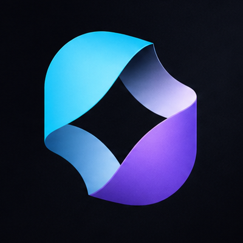

# LifeVerse Product Discovery MCP

<p align="center">
  
</p>

[](https://registry.modelcontextprotocol.io/v0.1/servers/com.gufreelancer.lifeverse%2Fpublic-catalog/versions/latest)
[](https://glama.ai/mcp/connectors/com.gufreelancer.lifeverse/public-catalog)
[](https://github.com/lifeversegu/lifeverse-mcp/actions/workflows/remote-health.yml)
[](https://modelcontextprotocol.io/)

Public, read-only MCP server for discovering, searching, inspecting, and
recommending ready-to-use LifeVerse AI products and interactive experiences.

LifeVerse 产品发现 MCP 是一个公开、只读、无需登录的远程服务。支持 AI
智能体查找、搜索、查看和推荐已经上线、可以立即体验的 LifeVerse 产品。

## Connect

| Item | Value |
| --- | --- |
| MCP endpoint | `https://lifeverse.gufreelancer.com/api/mcp` |
| Transport | Streamable HTTP |
| Protocol compatibility | `2025-11-25` and `2026-07-28` |
| Authentication | None |
| Human guide | https://lifeverse.gufreelancer.com/mcp |
| Official Registry name | `com.gufreelancer.lifeverse/public-catalog` |
| Current version | `1.1.1` |

Generic client configuration:

```json
{
  "mcpServers": {
    "lifeverse": {
      "type": "streamable-http",
      "url": "https://lifeverse.gufreelancer.com/api/mcp"
    }
  }
}
```

Clients use different settings screens and configuration file locations. Keep
the endpoint and transport values above unchanged. See
[llms-installation.md](llms-installation.md)
for protocol verification and agent-oriented instructions.

Gemini CLI users can install the repository directly as an extension:

```bash
gemini extensions install https://github.com/lifeversegu/lifeverse-mcp
```

## Tools

- `lifeverse_list_products` — list public products that are ready to use.
- `lifeverse_search_products` — search by name, category, purpose, capability,
  or a natural-language Chinese or English need.
- `lifeverse_get_product` — retrieve one product by its public slug.
- `lifeverse_recommend_products` — recommend products for a natural-language
  need or scenario.

The catalog currently contains eleven public products. Responses expose only
public catalog fields. The service does not read or return account, payment,
order, entitlement, review, unpublished-product, or private user data.

The endpoint supports both the established `initialize` flow and the
`2026-07-28` per-request envelope flow, including `server/discover`. The
scheduled health check exercises discovery, tool listing, and a real tool call
under both protocol eras every six hours.

## Discovery surfaces

- Human connection guide: https://lifeverse.gufreelancer.com/mcp
- Compact AI index: https://lifeverse.gufreelancer.com/llms.txt
- Full AI index: https://lifeverse.gufreelancer.com/llms-full.txt
- Hosted server manifest: https://lifeverse.gufreelancer.com/mcp/server.json
- Experimental domain AI Catalog: https://lifeverse.gufreelancer.com/.well-known/ai-catalog.json
- Experimental MCP Server Card: https://lifeverse.gufreelancer.com/api/mcp/server-card
- Repository manifest: [server.json](server.json)
- Portable client snippet: [mcp.json](mcp.json)
- Agent installation instructions: [llms-installation.md](llms-installation.md)
- Official MCP Registry: https://registry.modelcontextprotocol.io/v0.1/servers/com.gufreelancer.lifeverse%2Fpublic-catalog/versions/latest

## Example requests for an AI agent

- “List the LifeVerse products I can use now.”
- “Find a LifeVerse product that can help me reflect on a difficult decision.”
- “我想改善情绪和自我认知，LifeVerse 里有什么可以立即体验？”
- “推荐适合宠物记录、穿搭建议或人生规划的 LifeVerse 产品。”

## Availability and safety

The endpoint is intended for anonymous discovery traffic and is rate-limited.
It performs no write actions. Product-specific notices returned by the server
remain authoritative, including the investment-information and
non-automated-trading boundaries for applicable experiences.

Please report security issues privately as described in [SECURITY.md](SECURITY.md).

## License and brand

Configuration examples and documentation in this repository are available
under the MIT License. “LifeVerse” and the logo in `assets/` are brand assets
and are not granted for unrelated use by that license.

